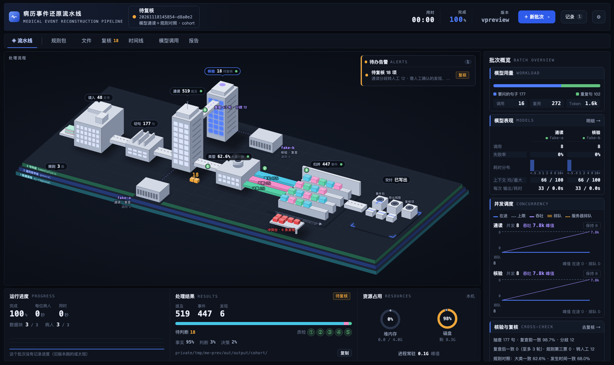
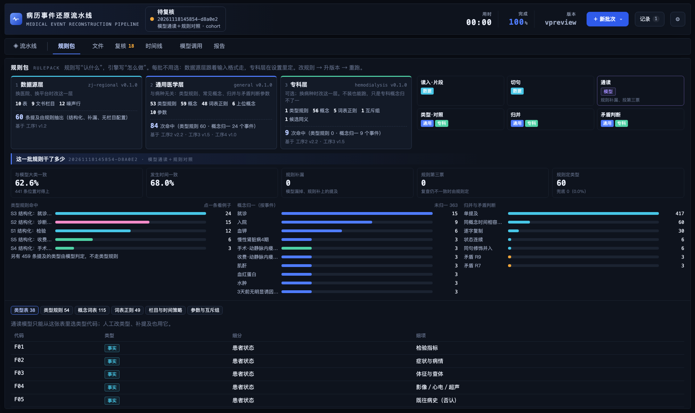
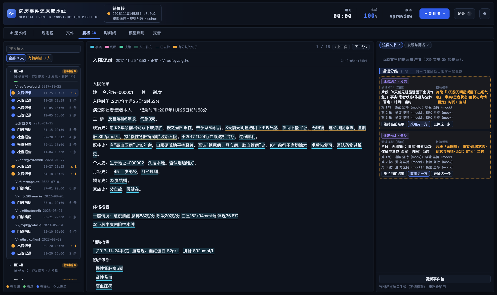
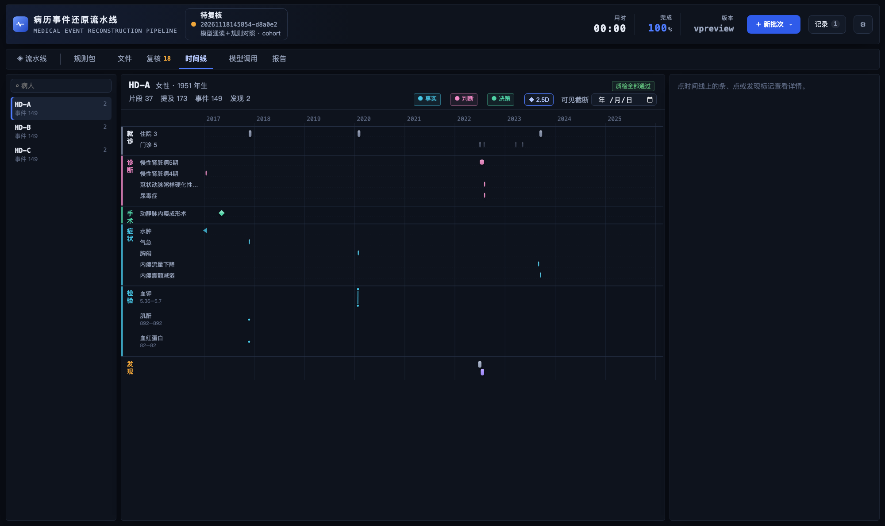

<div align="center">

# Medical Event Reconstruction Pipeline · dsh-medical-event

**Turn years of a patient's clinical records into computable events: every mention, two timestamps, a type, mentions of the same thing merged, and conflicts between records logged — all traceable to the original text.**

[简体中文](https://github.com/wld007/dsh-medical-event/blob/main/README.md) · English

A DeepSeek Harness plugin · model reading + two-model cross-checking + rule comparison · three-layer rule packs · records go only to your own model endpoints

[](https://www.npmjs.com/package/dsh-medical-event)




<sub>Generated with fictional patients (`test/fixtures`) and a local mock model endpoint: three-layer rule-pack base → intake → sentence cutter → reading tower and verification tower (the bridge is the review loop) → three type chutes → time-shelved event warehouse and conflict desk → delivery. The UI is in Chinese.</sub>

</div>

---

## What it does

```
De-identification → [Event reconstruction] → event packages → clinical ontology → long-course clinical reasoning eval
                                                  └→ record QA, real-world studies (drug exposure, lab series), training data, patient timelines…
```

Unlike chart abstraction (a template of a few dozen fields), this plugin records **every mention** and needs no template:

- **One row per mention**: coordinated diagnoses, symptoms and denials are split, with modifiers (denies, no, given) inherited. Each mention carries its character offsets, located by the plugin in the original text; positions from the model are never trusted.
- **Two timestamps**: when it was written (decides what was knowable at the time; used for evaluation cut-offs) and when it happened (the model copies the time phrase, code resolves it against the writing and admission dates).
- **Type**: fact / judgement / decision → subdivision → item (38-item taxonomy), plus templating, temporality, action, execution status, certainty and adherence.
- **Events and conflicts**: mentions of the same thing are merged into events, corroborations are linked but not merged; contradictions, revisions, adjustments, disease progression and documentation problems are logged as findings with a suggested source to trust — never resolved silently.
- **No disease knowledge in the engine**: rule packs are layered into data source, general medicine and specialty (e.g. haemodialysis). It runs without a specialty pack.
- **Copy, don't infer**: what isn't written stays unwritten.

## Reading: the model reads, rules execute

Mentions and types (steps 1–2) are read by models and checked against rules; merging and conflict detection (steps 3–4) run on the rule packs.

```
               ┌── reading model: split each sentence into mentions, type code, negation, action, copy the time phrase ──┐
sentence ──────┤                                                                                                         ├─→ compare (span / type / time / missed)
units (dedup)  └── verifying model: on sampled sentences, review each mention, give type and time blind, add what was missed ─┘
                     agree ─→ adopt
                     disagree ─→ review: the reading model sees the other answer and its reason, keeps or switches; then the verifier does the same;
                                         adopt as soon as they agree ("review round N"), up to 3 rounds (1–6)
                                      ─→ still disagree ─→ hybrid: the side the rules support at the same spot wins (rule tie-break)
                                                         ─→ otherwise ─→ to a human (reading model's answer kept meanwhile)
```

- **Only the quoted text is trusted**: spans that cannot be found in the original, or type codes outside the taxonomy, are rejected.
- **Rules are a party too**: in hybrid mode the rules extract the same text again; meaningful text the model missed is filled in from rules, and rules break ties after review. In `model` mode they are only compared.
- **Each sentence is asked once**: identical sentences (with the preceding sentence as context in narrative sections, same record type and section) are asked once across documents and patients; answers are cached and reused across batches.
- **Adjustable sampling**: by default the verifier checks 10% of sentences (stable, content-based sampling) to measure agreement (gate ⑤, measured before review); set it to 100% for high-stakes batches.
- **Human decisions stick**: stored by stable id, applied wherever the same sentence occurs and on every re-run.

## Three-layer rule packs

Rules say *what to recognise*; the engine says *how*. Nothing to pick per batch: the data-source layer follows the input format, the specialty layer is a setting.



| Layer | Covers | Change it when |
|---|---|---|
| Data source `rules/source/` | Platform fields, document types and sections, default time per section, void flags, timestamp traps; assembled by format recognition for other exports | Switching hospital or platform |
| General medicine `rules/general/` | Type rules, common symptoms, lab aliases, drug-name normalisation, merging and conflict parameters | Rarely |
| Specialty `rules/specialty/<disease>/` | Specialty concepts (e.g. dry weight, dialysis prescription, fistula surgery), mutually exclusive drug groups | Switching disease area |

The Rule-pack page shows the three layers and the steps each one drives, how much the rules did in this batch (agreement with the model, gap filling, tie-breaks, rule-typed mentions and fallback rate, top type rules and concepts), and lets you click any rule or concept to see matching mentions from the batch.

## Input

Usually the delivery folder of the de-identification plugin; one folder may hold many patients (one sub-folder each).

- **Regional platform exports** (`p_doc_*.json`, one file per month): built in.
- **Other exports** (json, ndjson, csv, tsv, xlsx; any field names, including data-element codes; fields may hold base64 XML/HTML documents): go through **format recognition** first. Each table is profiled locally; rules, the reading model and the verifier each draft a reading, which is adopted automatically only when they agree; disagreements are reviewed, and anything still open waits on the Formats tab for a person. Results are kept in a local format library and shared with the chart-abstraction plugin. Only field names, statistics and up to three 20-character samples are sent — never note text.
- **Plain-text documents** (one `.txt`/`.md` per document): type from the file name, writing time from a labelled date in the text, sections from line-start labels such as "主诉：". No model call.

## Install and configure

Requires DSH `>= 0.2.1` and Node.js `>= 22.5` (the record store uses `node:sqlite`). Install `dsh-medical-event` from the DeepSeek Harness plugin manager, then open Settings → 病历事件还原:

- **Reading model** (required): an OpenAI-compatible `/v1` endpoint and model name (pick from the list, "test connection"). Batches cannot start without it.
- **Verifying model** (recommended): another endpoint and model for sampled verification and review. Prefer a different model from the reader.
- **Reading and verification**: mode (hybrid / model), specialty pack, sampling rate, agreement threshold, review rounds.
- **Calls**: per-model concurrency, auto-tuned from throughput and server queueing by default; thinking mode off by default.

Tested with `qwen3.8-27b-fp8` (reading) and `gemma-4-26b-a4b-it` (verifying) served by vLLM. Clinical text goes only to these endpoints; for patient data use a local or intranet service.

## Usage

- **Sidebar → 病历事件还原**: opens the pipeline page; "＋ 新批次" starts a batch on a patient export folder. Tabs: pipeline, rule pack, formats, files, review, timeline, model calls, report.
- **Chat**: `/event <patient export folder> [--mode hybrid|model] [--out output root] [--as-of "YYYY-MM-DD HH:mm"]`
- **Agent tools**: `event_start`, `event_status`, `event_report`, `event_runs`, `event_cancel`, `event_formats`. Agents cannot choose endpoints, models or API keys.

### Review, document by document



- Left: patients and documents grouped by encounter. Centre: the text, mentions coloured by type (fact cyan, judgement pink, decision green), disputed sentences underlined in orange. Right: details of the selected mention and the reading disagreements in this document; a second pane lists findings and drug-name mappings needing confirmation.
- Remove a mention, change its type or time, or select text to add a missed mention (offsets are checked against the original).
- Each disagreement shows both models' answers and their reasons round by round; keep the current answer, switch to the other side, or drop it.
- "更新事件包" rebuilds the delivered packages from all human decisions without calling a model; once nothing is left open, the batch moves from "needs review" to "done".

### Timeline



Swim lanes by type (encounters, diagnoses, dialysis, drugs, surgery, symptoms, labs, findings), an optional visibility cut-off, and event details with all mentions, links and findings.

## Pipeline and quality gates

| Step | What | Gate |
|---|---|---|
| S00 Format recognition (non-built-in) | Profile → reuse from library → rule draft + two model drafts → check → adopt on agreement, review disagreements, hold the rest | Held tables are skipped |
| S01 Intake · fragments | Fragments, visibility time, void records, second admission notes, signed diagnosis sections, billing-period pseudo-stays | — |
| S02 Reading (step 1) | Sentence cutting · dedup → reading model → verification · review | ① mentions match the text verbatim, intervals well-formed, not after writing; ⑤ agreement before review ≥ 0.9 |
| S03 Types · rule comparison (step 2) | Model types adopted; rules fill gaps and derive the other attributes | ② fallback-rule rate (for spot checks) |
| S04 Merging · corroboration (step 3) | Seven merge rules, concept normalisation, drug segments, links | ③ each mention belongs to exactly one event |
| S05 Conflicts (step 4) | R1–R10, seven verdicts, source reliability suggests what to trust | ④ every finding traces back to mentions |
| S06 Human review | Reading disagreements, mentions (remove / change / add), findings, drug mappings | Decisions stored by stable id, reused on re-runs |
| S07 Delivery | Event packages + export views + cohort tables; read-only source check | — |

Patients failing ①, ③ or ④ stop at that step and are not handed downstream.

## Output

```text
<output root>/                       # default: _medical-event next to the input
  output/<input name>/<patient>/      # event package (docs/event-package.md, event-package/1); downstream reads only output
    manifest.json fragments encounters mentions events findings clues links reviews stage-changes.json
    exports/drug_exposure.csv labs_long.csv extraction_samples.jsonl (optional 结果.xlsx)
  output/<input name>/_cohort/        # cohort tables (several patients)
  _records/
    records.sqlite                    # batches, data blocks, model cache, call stats, human decisions with history
    runs/<batch>/report.md report.json work/ (plan, review lists) staging/ (packages while running, cancelled or failed)
```

Re-running the same input replaces the delivery. Sources are read-only. The package format only gains fields; changes bump the version.

## Scale

- **Data blocks**: patients are grouped (`shardUnits`, default 4) and processed on worker threads (CPU count − 1, up to 8). Cancelled or failed batches resume, reusing finished blocks and model answers.
- **Model calls**: one global limiter per model shared by all threads, auto-tuned from throughput and server queueing; deduplication leaves about a third of the sentences (measured on dialysis patients).
- **Record store**: `node:sqlite` with schema versioning in `PRAGMA user_version`; migrates on upgrade and refuses newer databases.

## Privacy and principles

Shared with the dsh-medical plugin family ([docs/family.md](docs/family.md)):

- The only outbound requests go to your configured model endpoints; reports contain no clinical text.
- Inputs are never modified; model-reported positions are never used; nothing is inferred or filled in.
- Stable ids (fragments, mentions, events, findings, review items are content-derived), so human decisions carry over.
- Cut-offs use only the time a record was written (`asOf`).
- Event packages contain note text; treat them as protected health information. Feed de-identified input where possible.

## Development

```sh
npm test                                  # tests (fictional patients + mock models, no network)
node scripts/build.mjs 0.3.0-dev.N        # build dist/<version>, then install from the profile
REACT_UMD_DIR=<node_modules with react/umd> node scripts/preview-page.mjs <stateDir>   # preview the page outside DSH
```

## License

MIT
