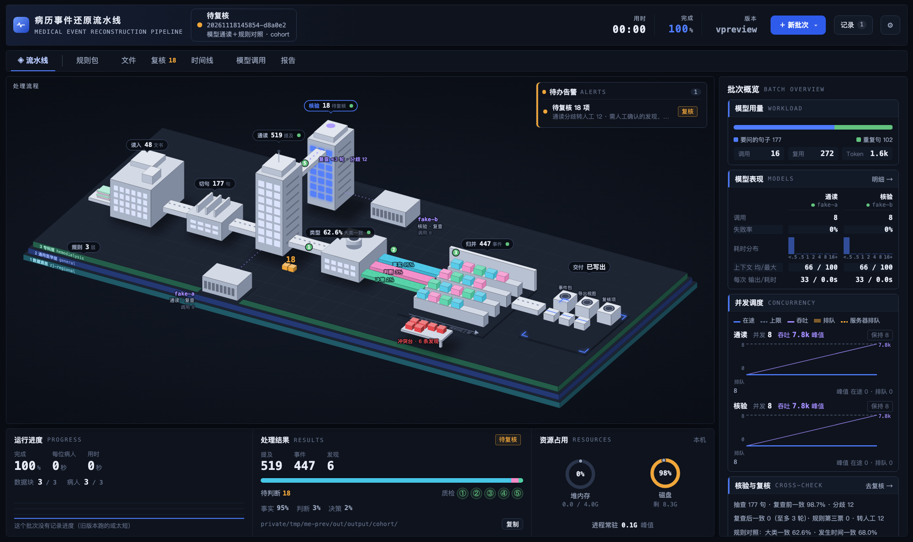
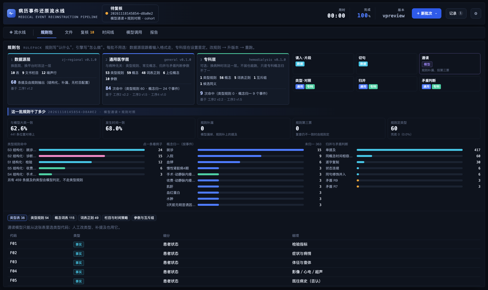
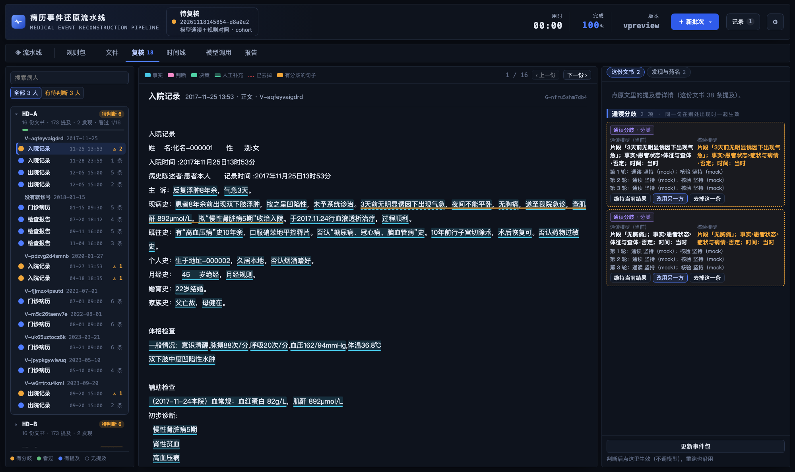
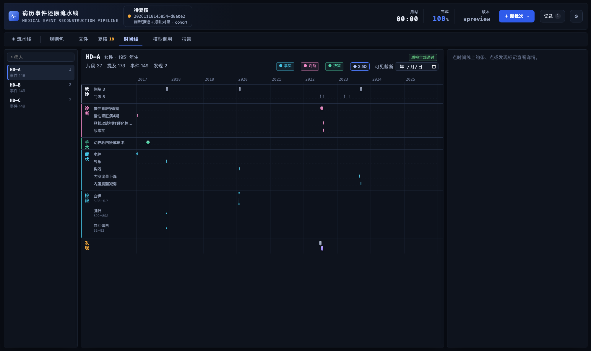

<div align="center">

# 病历事件还原流水线 · dsh-medical-event

**把一位患者多年的病历变成可计算的事件：每处提及、两个时间、类型，同一件事归并，记录之间的冲突登记在案——处处回得到原文。**

简体中文 · [English](https://github.com/wld007/dsh-medical-event/blob/main/README.en.md)

DeepSeek Harness 插件 · 模型通读＋双模型交叉核验＋规则对照 · 三层规则包 · 病历只发往你自己的模型端点

[](https://www.npmjs.com/package/dsh-medical-event)




<sub>截图用虚构病人（`test/fixtures`）和本机假模型端点生成：三层规则包底座 → 进料口 → 切句 → 通读塔与核验塔（天桥是复查）→ 三条类型滑道 → 按时间上架的事件仓库与冲突台 → 交付。</sub>

</div>

---

## 它做什么

```
医疗数据匿名化 → 【病历事件还原】 → 事件包 → 临床本体构建 → 长病程临床推理评测
                                       └→ 病历质控、真实世界研究（用药暴露、检验长表）、训练数据、患者时间线……
```

和病历文书提取（按模板只取几十个字段）不同，这里**每处提及都记**，不需要模板：

- **每处提及一条**：并列的诊断、症状、否认项按顿号拆开，修饰（否认、无、予）继承；带片段内起止位置，位置由插件在原文里找，模型给的位置一律不用。
- **两个时间**：写成时间（决定“当时能不能看到”，评测截断用）和所说的发生时间（模型抄出时间短语，代码按写成时间、入院时间换算）。
- **类型**：事实／判断／决策 → 细分 → 细项（类型表 38 项），以及模板化、时间性质、动作、执行状态、确定程度、依从。
- **事件与冲突**：同一件事的提及归并成事件，前后印证只连不并；矛盾、改判、调整、病情变化、记录质量问题登记为发现，给建议采信，不自动选边。
- **引擎里没有病种知识**：规则包分数据源层、通用医学层、专科层（如血透），不装专科包也能跑。
- **只照抄原文、不推断、不补全**：没写的就是没写。

## 通读：模型读懂，规则执行

提及与类型（工序 1–2）由模型通读，规则作对照；事件归并与矛盾判断（工序 3–4）按规则包算。

```
            ┌──── 通读模型：逐句拆成提及，给类型代码、否定、动作，抄出管这件事的时间短语 ────┐
句子单位 ────┤                                                                    ├─→ 比较（边界／分类／时间／遗漏）
（去重）     └──── 核验模型：抽查的句子逐条审通读结果，背靠背给类型与时间，补漏掉的 ─────┘
                     一致 ─→ 采用
                     不一致 ─→ 复查：通读模型看核验模型的答案和理由坚持或改，再轮到核验模型，
                                     任一步一致即采用（标「复查第 N 轮」），至多 3 轮（可设 1–6）
                                  ─→ 仍不一致 ─→ hybrid：规则在同一处的结论支持哪一方就用哪一方（规则第三票）
                                                ─→ 再定不了 ─→ 转人工（先按通读模型的答案，复核页可改）
```

- **只信原文片段**：模型抄的片段回原文定位，对不上的、类型不在类型表里的当场拦下。
- **规则也是一方**：hybrid 模式下规则在同一处再抽一次，模型没覆盖的有意义文字用规则补上；复查仍不一致时投第三票。`model` 模式只作对照统计。
- **同一句只问一次**：句子（叙述栏目带上一句作上文）＋记录类型＋栏目相同的，跨文书、跨病人只问一次；答案按句子缓存，各批次复用。
- **抽样可调**：核验模型默认抽查 10% 的句子（按句子内容稳定抽样），用来测通读的一致率（质检⑤，按复查前算）；要求高的批次设为全部核验。
- **人工判断按稳定编号沿用**：同一句在别的文书、别的病人里出现时一起生效；重跑也沿用。

## 三层规则包

规则写「认什么」，引擎写「怎么做」。每批不用选：数据源层跟着输入格式走，专科层在设置里定。



| 层 | 管什么 | 换什么时改 |
|---|---|---|
| 数据源层 `rules/source/` | 平台字段、文书类型与栏目、栏目默认时间、作废标记、时间字段陷阱；非区域平台导出由格式识别自动组装 | 换医院、换平台 |
| 通用医学层 `rules/general/` | 类型规则、常见症状、检验别名、药名归一，归并与矛盾判断的参数 | 一般不改 |
| 专科层 `rules/specialty/<病种>/` | 专科概念（如血透的干体重、透析方案、内瘘手术）、互斥用药组 | 换病种 |

「规则包」页上半部画出三层与各自管的工序，以及这一批规则实际干了多少（与模型的一致率、补漏、第三票、规则定类型与兜底率，类型规则与概念归一的命中排行），点任何一条规则或概念看本批命中的原文例子。

## 输入

通常是匿名化插件的交付目录；一个目录可含多位病人（一个文件夹一位）。

- **区域平台导出**（`p_doc_*.json`，按月分文件）：内置格式，直接处理。
- **其他导出**（json、ndjson、csv、tsv、xlsx；字段名不限，包括数据元编码；字段里可以是 base64 编码的 XML／HTML 病历文书）：先过**格式识别**——每张表在本机画像，规则、通读模型、核验模型各起草一份读法，一致才自动采用，有分歧的先复查，仍不一致停在「格式」页由人确认；结果存进本机格式库复用，也借用病历文书提取插件已采用的识别结果。发给模型的只有字段名、统计、≤3 个截到 20 字的样例，不发正文。
- **纯文本文书**（一个 `.txt`／`.md` 一份文书）：类别看文件名，写成时间取正文里带标签的日期，正文按「主诉：」这类行首标签切栏目，不问模型。

## 安装与配置

要求 DSH `>= 0.2.1`、Node.js `>= 22.5`（记录库用 `node:sqlite`）。在 DeepSeek Harness 的插件管理里安装 `dsh-medical-event`，然后在设置 →「病历事件还原」里配置：

- **通读模型**（必填）：OpenAI 兼容的 `/v1` 端点＋模型名，可从下拉选、「测试连接」检查。没有配置时不能开始批次。
- **核验模型**（建议）：另一个端点＋模型，开启抽样核验与复查。最好和通读模型不是同一个。
- **通读与核验**：模式（hybrid／model）、专科规则包、抽查比例、一致率阈值、复查轮次。
- **调用**：两个模型各自的并发，默认按吞吐与推理服务器排队情况自动调整；关闭思考模式（默认开）。

开发和测试中使用的组合：vLLM 部署的 `qwen3.8-27b-fp8`（通读）和 `gemma-4-26b-a4b-it`（核验）。病历内容只发往这里配置的端点，处理患者数据请使用本机或机构内网的服务。

## 用法

- **左侧栏「病历事件还原」**：打开「病历事件还原流水线」页面，点「＋ 新批次」选病人导出目录。页面有流水线、规则包、格式、文件、复核、时间线、模型调用、报告几页。
- **聊天框**：`/event <病人导出目录> [--mode hybrid|model] [--out 输出根目录] [--as-of "YYYY-MM-DD HH:mm"]`
- **Agent 工具**：`event_start`、`event_status`、`event_report`、`event_runs`、`event_cancel`、`event_formats`。Agent 不能指定端点、模型或 API Key，始终用已保存的设置。

### 复核：逐份核对



- 左＝病人与文书（按就诊分组），中＝原文：提及按类型着色（事实青、判断粉、决策绿），有分歧的句子标橙；右＝这份文书的提及详情与通读分歧，另一页是这位病人需人工确认的发现与药名映射。
- 提及可以去掉、改类型、改发生时间；在原文里选中文字可以补一条漏提的提及（插件按原文核对位置）。
- 通读分歧列出两个模型的答案和每一轮复查的理由，可维持、改用另一方或去掉。
- 「更新事件包」不调模型，按全部人工判断重新生成交付数据；转人工的都判断了，批次从「待复核」转为「完成」。

### 时间线



按类型分泳道（就诊、诊断、透析、用药、手术、症状、检验、发现），可设可见截断线，点事件看各方提及、印证关系与发现。

## 流水线与质检

| 环节 | 做什么 | 质检 |
|---|---|---|
| S00 格式识别（非内置格式） | 画像 → 格式库复用 → 规则方案＋两个模型起草 → 校验 → 一致采用、分歧复查、仍不一致暂扣待确认 | 暂扣的表不参与 |
| S01 读入·片段 | 片段、可见时间、作废记录、第二版入院记录、签名诊断段、计费周期“住院” | — |
| S02 通读（工序1） | 切句·去重 → 通读模型拆提及、找时间短语 → 核验·复查 | ① 提及与原文逐字一致、区间不倒置、不晚于写成；⑤ 核验一致率（复查前）≥ 0.9 |
| S03 类型·对照（工序2） | 模型判定的类型直接采用；规则补漏、推出其余属性 | ② 兜底规则命中率（供抽查） |
| S04 归并·印证（工序3） | 七级归并规则、概念归一、用药片段、印证关系 | ③ 每条提及恰属一个事件 |
| S05 矛盾判断（工序4） | R1–R10，七类判定，来源可信度给建议采信 | ④ 每条发现可回溯原始提及 |
| S06 人工复核 | 通读分歧、提及（去掉／改／补）、需人工确认的发现、药名映射 | 判断按稳定编号存，重跑沿用 |
| S07 交付 | 事件包＋导出视图＋整批汇总表；源文件只读核对 | — |

①③④ 不通过的病人，事件包停在那一步，不往下游交。

## 交付

```text
<输出根目录>/                        # 默认：输入旁边的 _medical-event
  output/<输入名>/<病人>/             # 事件包（docs/event-package.md，event-package/1）；下游只读 output
    manifest.json fragments encounters mentions events findings clues links reviews stage-changes.json
    exports/drug_exposure.csv labs_long.csv extraction_samples.jsonl（结果.xlsx 可选）
  output/<输入名>/_cohort/            # 整批汇总表（多位病人时）
  _records/
    records.sqlite                   # 批次、数据块、模型回复缓存、调用统计、人工判断及改动留痕
    runs/<批次>/report.md report.json work/（规划、复核单）staging/（运行中、取消或失败时的事件包）
```

同一输入重跑时以最新结果替换。源文件只读，绝不修改。事件包格式见 [docs/event-package.md](docs/event-package.md)，字段只增不改，改动升版本。

## 规模

- **数据块**：病人按 `shardUnits`（默认 4 位）分成数据块，工作线程并行（默认 CPU 数减 1，最多 8 个）。取消或失败后「继续」，已完成的数据块和模型回答直接复用。
- **模型调用**：两个模型各一个全局限流，所有工作线程共用，按吞吐和服务器排队自动调并发；句子去重后约为原句数的 1/3（血透病人实测）。并行的病人里第一次出现的同一句可能各问一次。
- **记录库**：`node:sqlite`，表结构版本记在 `PRAGMA user_version`，升级时自动迁移；库比插件新时拒绝打开。

## 隐私与原则

沿用 dsh-medical 插件家族的约定（[docs/family.md](docs/family.md)）：

- 唯一的出站请求是你配置的模型端点；报告不含病历原文。
- 绝不修改输入；模型给的位置一律不采用；不做补全。
- 编号稳定（片段、提及、事件、发现、复核项都由内容派生），人工判断按编号沿用。
- 只按可见时间截断（`asOf`）：评测用“截至某时刻”重算全部结论。
- 事件包含片段原文，按受保护健康信息对待；输入最好是匿名化插件的输出。

## 文档

[插件家族与共同约定](docs/family.md) · [交接说明](docs/brief.md) · [引擎架构与规则包格式](docs/architecture.md) · [事件包格式](docs/event-package.md) · [真实数据验证](docs/validation.md) · [工序 1–4 设计](docs/reference)

## 开发

```sh
npm test                                  # 测试（虚构病人＋假模型，不需要网络或真实数据）
node scripts/build.mjs 0.3.0-dev.N        # 生成 dist/<版本>，再从 profile 安装
node scripts/llm-experiment.mjs <outDir> <病人目录>… --a <url>@<模型> --b <url>@<模型>   # 通读与规则基线对照（输出不进仓库）
REACT_UMD_DIR=<含 react/umd 的 node_modules> node scripts/preview-page.mjs <stateDir>   # 在 DSH 之外预览页面
```

## 许可

MIT
